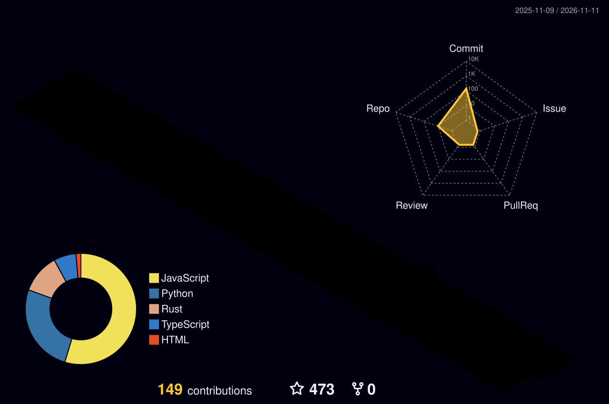

<!-- ═══════════════════════════════════════════════════════════════
     HEADER · animated waving banner
     ═══════════════════════════════════════════════════════════════ -->
<div align="center">


<a href="https://mohamedelhaddioui.netlify.app/">
  
</a>

<br/>

<a href="https://mohamedelhaddioui.netlify.app/"></a>
<a href="https://www.linkedin.com/in/mohamed-el-haddioui/"></a>
<a href="mailto:mohamedelhaddioui99@gmail.com"></a>


</div>

<br/>

<!-- ═══════════════════════════════════════════════════════════════
     ABOUT · terminal style
     ═══════════════════════════════════════════════════════════════ -->
## 🧑‍💻 About Me

```python
class MohamedElHaddioui:
    role       = ["AI Agent Engineer", "LLM Software Engineer", "Backend & Data Engineer"]
    education  = "Computer Engineer · ENSET Mohammedia (2024)"
    focus      = ["Generative AI", "RAG", "AI Agents", "MCP", "Big Data", "Cloud"]
    languages  = {"Amazigh": "Native", "Arabic": "Native", "French": "Fluent", "English": "Fluent"}
    philosophy = "Build useful things, solve meaningful problems, make technology reliable."

    def currently(self):
        return "Shipping AI-powered products with solid software engineering."
```

I'm a Computer Engineer specializing in **Big Data, Cloud Computing, Software Engineering, and Artificial Intelligence**. I build intelligent applications and scalable systems, combining modern AI with rigorous engineering principles.

<br/>

<!-- ═══════════════════════════════════════════════════════════════
     WHAT I BUILD
     ═══════════════════════════════════════════════════════════════ -->
## 🚀 What I Build

<table>
<tr>
<td width="50%" valign="top">

### 🤖 AI & Agentic Systems
- Retrieval-Augmented Generation (RAG)
- AI Agents & Multi-Agent Workflows
- MCP & Tool Calling
- LLM Integration & Evaluation
- Multilingual AI Applications

</td>
<td width="50%" valign="top">

### ⚙️ Software & Backend
- RESTful APIs & Microservices
- Distributed Systems
- Authentication & RBAC
- Database Architecture
- Performance & Reliability

</td>
</tr>
<tr>
<td width="50%" valign="top">

### 📊 Data Engineering
- Apache Spark & Kafka
- Real-Time Data Processing
- PostgreSQL & Redis
- Vector Search & Embeddings
- Data Pipelines

</td>
<td width="50%" valign="top">

### ☁️ Cloud & Infrastructure
- Docker & Kubernetes
- AWS & Cloud Services
- CI/CD Automation
- Monitoring & Observability
- Scalable Deployments

</td>
</tr>
</table>

<br/>

<!-- ═══════════════════════════════════════════════════════════════
     TECH STACK
     ═══════════════════════════════════════════════════════════════ -->
## 🛠️ Technology Stack

<div align="center">

**Languages**


**AI · Machine Learning · LLMs**


**Backend & Frontend**


**Databases & Data Engineering**


**Cloud, DevOps & Tools**


</div>

<br/>

<!-- ═══════════════════════════════════════════════════════════════
     3D CONTRIBUTIONS (generated by the workflow in .github/workflows)
     ═══════════════════════════════════════════════════════════════ -->
## 🧊 3D Contribution Skyline

<div align="center">
  
</div>

<br/>

<!-- ═══════════════════════════════════════════════════════════════
     FEATURED PROJECTS
     ═══════════════════════════════════════════════════════════════ -->
## 📌 Featured Projects

<table>
<tr>
<td width="50%" valign="top">

### 🕸️ [EchoGraph](https://github.com/MOHAMED-EL-HADDIOUI/EchoGraph)
Turns meeting notes, chat, email and audio into a **provenance-first knowledge graph**. Every fact keeps its source quote.

  

</td>
<td width="50%" valign="top">

### 🛡️ [Aegis-MCP](https://github.com/MOHAMED-EL-HADDIOUI/Aegis-MCP)
**Zero-trust security gateway for MCP.** Intercepts every tool call and blocks prompt injection, exfiltration and destructive operations.

  

</td>
</tr>
<tr>
<td width="50%" valign="top">

### 🐉 [Hydra](https://github.com/MOHAMED-EL-HADDIOUI/Hydra)
Self-hosted **LLM gateway** that aggregates 28 free provider tiers behind one OpenAI-compatible `/v1` proxy, with smart auto-routing.

  

</td>
<td width="50%" valign="top">

### 🐝 [BeeCode](https://github.com/MOHAMED-EL-HADDIOUI/BeeCode)
**Terminal-native AI coding agent in Rust.** Understands your codebase, edits files and runs commands, and works with any provider.

  

</td>
</tr>
</table>

<div align="center">
  <a href="https://github.com/MOHAMED-EL-HADDIOUI?tab=repositories"></a>
</div>

<br/>

<!-- ═══════════════════════════════════════════════════════════════
     GITHUB STATS
     ═══════════════════════════════════════════════════════════════ -->
## 📈 GitHub Activity

<div align="center">
  
  
</div>

<div align="center">
  
</div>

<br/>

<!-- ═══════════════════════════════════════════════════════════════
     SNAKE (generated by the workflow in .github/workflows)
     ═══════════════════════════════════════════════════════════════ -->
## 🐍 Contribution Snake

<div align="center">
  <picture>
    <source media="(prefers-color-scheme: dark)" srcset="./assets/github-snake-dark.svg" />
    <source media="(prefers-color-scheme: light)" srcset="./assets/github-snake.svg" />
    
  </picture>
</div>

<br/>

<!-- ═══════════════════════════════════════════════════════════════
     LANGUAGES + CONNECT
     ═══════════════════════════════════════════════════════════════ -->
## 🌍 Languages

<div align="center">

| Language | Level |
|:--|:--|
| 🇲🇦 Amazigh |  |
| 🇲🇦 Arabic |  |
| 🇫🇷 French |  |
| 🇬🇧 English |  |

</div>

## 🤝 Let's Connect

I'm open to collaborating on challenging projects around **AI, LLM applications, backend engineering, and scalable software systems**.

<div align="center">

<a href="https://mohamedelhaddioui.netlify.app/">Portfolio</a> •
<a href="https://www.linkedin.com/in/mohamed-el-haddioui/">LinkedIn</a> •
<a href="https://github.com/MOHAMED-EL-HADDIOUI">GitHub</a> •
<a href="mailto:mohamedelhaddioui99@gmail.com">Email</a>

<br/>


</div>
